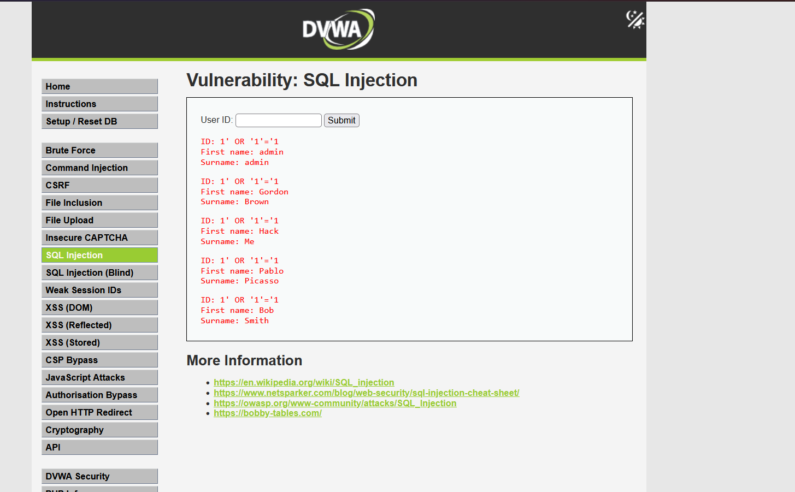
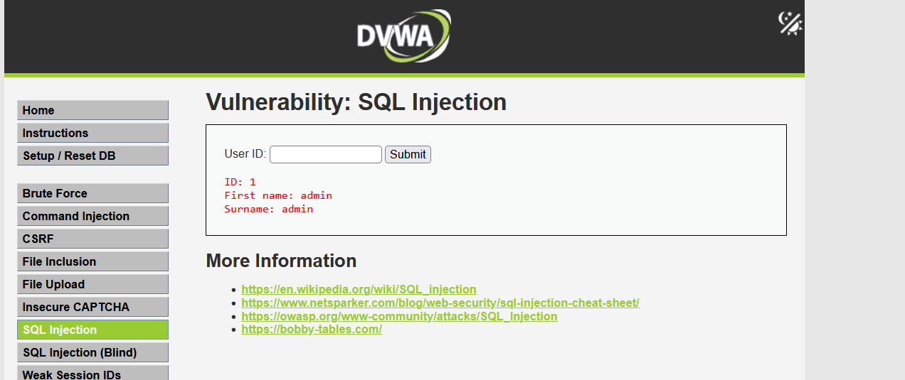
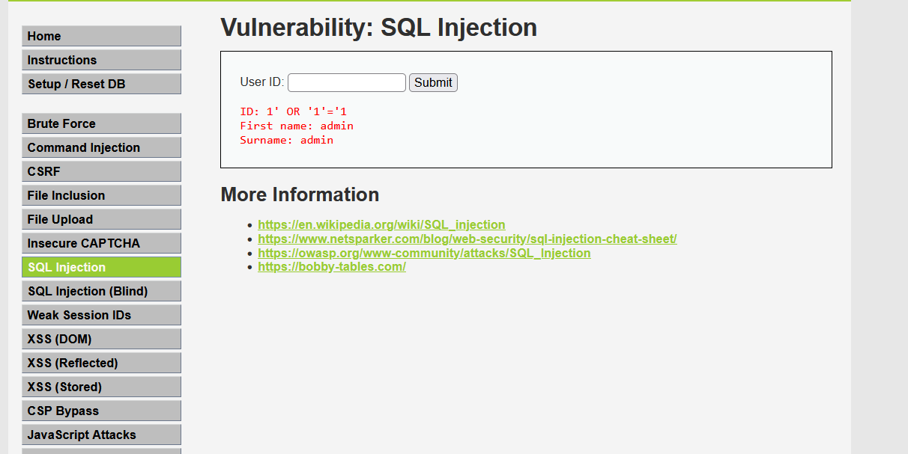

# Análisis técnico: SQL Injection

## 1. Descripción de la vulnerabilidad

SQL Injection es una vulnerabilidad que ocurre cuando una aplicación incorpora datos proporcionados por el usuario directamente en una consulta SQL sin separarlos correctamente de las instrucciones de la consulta.

Esto puede permitir que un atacante altere la lógica de la consulta y acceda a información que no debería obtener.

## 2. Identificación

- Aplicación: Damn Vulnerable Web Application (DVWA).
- Módulo: SQL Injection.
- Nivel de seguridad: Low.
- Archivo vulnerable: `vulnerabilities/sqli/source/low.php`.
- Tecnología: PHP y MySQL.

## 3. Causa de la vulnerabilidad

La vulnerabilidad se origina en la construcción dinámica de una consulta SQL mediante la concatenación directa de datos proporcionados por el usuario.

En el archivo `vulnerabilities/sqli/source/low.php`, la aplicación recibe el parámetro `id` mediante `$_REQUEST['id']` y lo incorpora directamente en la consulta:

```php
$id = $_REQUEST['id'];
$query = "SELECT first_name, last_name FROM users WHERE user_id = '$id';";
```

El problema es que la entrada del usuario no se separa de las instrucciones SQL mediante parámetros vinculados. Como consecuencia, un atacante puede introducir caracteres y expresiones SQL que alteren la lógica original de la consulta.

## 4. Clasificación OWASP

- Estándar: OWASP Top 10:2025.
- Categoría: A05:2025 – Injection (Inyección).
- Vulnerabilidad específica: SQL Injection.
- Identificador CWE: CWE-89 – Improper Neutralization of Special Elements used in an SQL Command.

Esta vulnerabilidad pertenece a la categoría de inyección porque los datos proporcionados por el usuario pueden ser interpretados como parte de las instrucciones ejecutadas por la base de datos.

## 5. Impacto y riesgo

La explotación de esta vulnerabilidad puede comprometer la confidencialidad, integridad y disponibilidad de la información almacenada en la base de datos.

En las pruebas realizadas sobre DVWA se comprobó que era posible alterar la condición de búsqueda y recuperar cinco registros de usuarios en lugar de únicamente el registro solicitado.

En un entorno real, dependiendo de los privilegios de la cuenta de base de datos y de las operaciones disponibles, esta vulnerabilidad podría ocasionar:

- Acceso no autorizado a información de otros usuarios.
- Exposición de datos personales o confidenciales.
- Modificación o eliminación no autorizada de registros.
- Compromiso de la integridad de la información.

El impacto concreto depende de los permisos de la conexión a la base de datos y de las funcionalidades expuestas por la aplicación.

El riesgo principal identificado en esta práctica es la posibilidad de acceder a registros que no corresponden a la consulta solicitada mediante la manipulación de la entrada del usuario.

## 6. Explotación en el entorno de pruebas

Se introdujo el valor `1` en el campo de búsqueda, obteniendo el registro correspondiente al usuario administrador.

Posteriormente, se utilizó el siguiente payload:

`1' OR '1'='1`

La aplicación devolvió cinco registros de usuarios, demostrando que era posible alterar la condición de búsqueda mediante una inyección SQL.

**Evidencia:** versión vulnerable.

## 7. Mitigación implementada

Se modificó la consulta SQL para utilizar una sentencia preparada mediante las funciones de MySQLi:

- `mysqli_prepare()`
- `mysqli_stmt_bind_param()`
- `mysqli_stmt_execute()`
- `mysqli_stmt_get_result()`

El parámetro se vinculó como un entero (`i`), evitando que el contenido introducido se interprete como parte de la estructura SQL.

## 8. Validación

Se realizaron nuevamente dos pruebas:

1. Consulta normal con el valor `1`: devolvió el usuario administrador.
2. Intento de inyección con `1' OR '1'='1`: devolvió únicamente el registro correspondiente al ID 1.

Los resultados permiten comprobar que el payload utilizado ya no altera la lógica de la consulta en la ruta MySQL probada.

## 9. Evidencias

### 9.1. Versión vulnerable

**Consulta normal:**


**Explotación mediante SQL Injection:**



### 9.2. Versión mitigada

**Consulta normal después de la mitigación:**



**Intento de inyección después de la mitigación:**



## 10. Conclusión

La implementación de consultas preparadas permitió mitigar la vulnerabilidad SQL Injection en la rama MySQL del módulo analizado de DVWA. Las pruebas posteriores demostraron que la consulta normal continúa funcionando y que el payload utilizado durante la explotación ya no permite recuperar múltiples registros.

La mitigación descrita se aplica a la ruta MySQL probada. La rama SQLite del módulo no fue modificada ni validada.